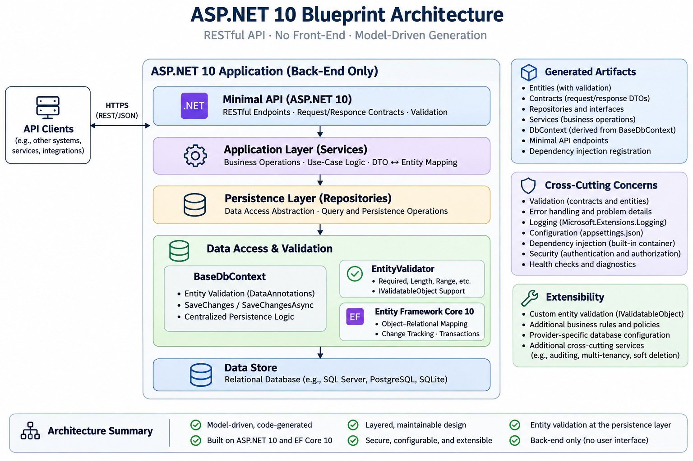

## Generated By
Harbormaster


## Generated For
- Name: Harbormaster Dev Team


## Application
- Name: treasuryonaspdotnet
- Description: Banking System
- Company Name: 

## Blueprint
- Name: ASP.NET-10
- Version: 1.1


## Domain Model
- Name: Treasury Capabilities Model
- Version: 1.0.0

### Entities

TreasuryUnit
TradingBook
Portfolio
Counterparty
NettingAgreement
CollateralAgreement
CollateralAccount
MarginCall
BankAccount
CashPosition
CashFlow
Trade
SettlementInstruction
FundingProgram
Issuance
Position
RiskLimit
LimitBreach
Approval
TreasuryPolicy
MarketDataSet
YieldCurve
CurveQuote
FXRate
VolSurface
RiskReport
RegulatoryMetric
LiquidityBuffer
BufferAsset
TransferPricingRule
InternalDeal
HedgeRelationship
AccountingEntry
StressScenario
StressResult
BusinessCalendar
Holiday

### Value Objects

Money
Rate
Tenor
ISIN
LegalEntityIdentifier
BIC
AccountIdentifier
TenorUnit

### Enums

BookCategory
InstrumentType
TradeStatus
Side
ClearingStatus
CashFlowType
NettingAgreementType
CollateralAgreementType
CollateralType
MarginDirection
MarginStatus
FundingInstrumentType
IssuanceStatus
LimitType
RiskMeasureType
ApprovalDecision
PolicyArea
CurveType
DayCountConvention
PricingModel
RiskReportType
ReportStatus
PositionType
RegMetricType
HQLAClass
LiquidityHorizon
TransferPricingMethod
HedgeDesignationStatus
LimitBreachStatus


## CI Platform
- Name: 

## GitHub
- Host: https://github.com
- Owner: Harbormaster-AI
- Repo: treasury-on-aspdotnet-10

## Docker
- Host: docker.io
- Org Name: theharbormaster
- Repository: treasury-onaspdotnet
- Tag: latest

## AWS
- accessKey: xxxxxxxxxxxxxxxx
- secretKey: xxxxxxxxxxxxxxxx
- region: us-east-2
- ec2InstanceType: 
- dbInstanceType: 
- vpc: xxxxxxxxxxxxxxx
- AMI Image Id: 


## ASP.NET 10 Details
### Overview

> ASP.NET Core 10 is a mature, cross-platform, enterprise-ready application framework built on .NET 10 that simplifies the development of
production-grade applications using C# 14. It provides comprehensive support for Minimal APIs, RESTful services, Entity Framework Core,
authentication, authorization, dependency injection, middleware, validation, asynchronous processing, and production monitoring.
Its high-performance runtime and modular architecture make it an excellent platform for building scalable microservices,
cloud-native solutions, and traditional enterprise applications.

### Architecture



> ASP.NET Core promotes a layered, component-based architecture that cleanly separates API endpoints, business logic, data access,
and infrastructure concerns. Its built-in dependency injection container, configurable middleware pipeline, and Minimal API framework
enable the development of scalable, maintainable, and testable enterprise applications.

Harbormaster generates a structured application architecture consisting of Minimal API endpoints, data transfer objects (DTOs),
business services, domain entities, persistence components, configuration, and automated tests, establishing a consistent
engineering foundation across generated applications.

### Security

> ASP.NET Core provides a comprehensive security framework for securing web applications, REST APIs, and microservices through
its integrated authentication and authorization middleware. It supports multiple authentication mechanisms, including
cookie-based authentication, JWT Bearer authentication, OAuth 2.0, OpenID Connect, and custom authentication schemes.

Authorization can be enforced through role-based, claims-based, policy-based, and resource-based access control,
allowing security requirements to be applied consistently across application endpoints and business operations.

### Logging

> ASP.NET Core provides a flexible and production-ready logging framework through Microsoft.Extensions.Logging.
It offers configurable logging levels, structured logging, categorized log messages, and extensible logging providers,
enabling developers to capture diagnostic, operational, security, and business events consistently across the application.

The logging architecture supports integration with console output, centralized logging platforms, application monitoring
services, and third-party logging frameworks such as Serilog and NLog.

### Auditing

> Harbormaster provides an auditing architecture designed to capture both entity-level changes and business-level operations
to establish comprehensive application traceability. Entity auditing records lifecycle events such as record creation,
modification, and deletion, while business auditing captures significant business activities performed through the service layer,
including the operation performed, user identity, organization, outcome, execution time, and contextual metadata.

ASP.NET Core and Entity Framework Core provide extensibility through middleware, change tracking, SaveChanges interceptors,
and service-layer components to support consistent auditing across application and persistence operations.

### Storage

> ASP.NET Core provides a robust persistence architecture through Entity Framework Core 10, simplifying the development of
database-driven applications while promoting a clean separation between business logic and data access.
It supports object-relational mapping (ORM), LINQ-based queries, change tracking, relationship management,
transaction management, asynchronous database operations, and database schema migrations.

Harbormaster generates the entity classes, DbContext configuration, entity relationships, persistence mappings,
and database configuration required to manage all entities discovered in a domain model.

The persistence architecture supports multiple database engines through configurable database providers,
allowing the underlying entity store to be selected without modifying the domain model.

### Telemetry

> ASP.NET Core and .NET 10 provide an extensible telemetry architecture through System.Diagnostics,
System.Diagnostics.Metrics, built-in application instrumentation, health checks, and OpenTelemetry integration.

Through configurable instrumentation, telemetry can capture service execution metrics, request throughput,
response times, error rates, resource utilization, distributed traces, and other operational indicators,
enabling proactive monitoring, capacity planning, and performance optimization.

This architecture provides operational visibility into application behavior, allowing development and operations teams
to detect performance issues, monitor service health, and continuously optimize system performance.

### Validation

> For each modeled entity, Harbormaster generates validation classes and methods to validate data before being persisted
to an entity store.

ASP.NET Core 10 supports Minimal API validation, data annotation-based validation, custom validation attributes,
and extensible validation mechanisms. These capabilities enable consistent enforcement of domain constraints,
data integrity requirements, and business validation rules across application endpoints and business services.

## Options

> The following options are available to be applied from the Web UI and a System-as-Code YAML file.

- apiUrl:        URL on which the ASP.NET Core application listens. Default: http://localhost:5076
- dbEngine:      Database engine to use for entity persistence. Options: postgres, mysql, sqlLite, oracle, sqlserver, mongdodb, inmemory, mariadb, azuresql
- dbName:        Name of the database used for entity persistence. Default: testDb
- dbHost:        Hostname or IP address of the database server. Default: localhost
- dbPort:        Port on which the database server listens. Default: 5432
- dbUsername:    Username used to authenticate with the database server. Default: postgres
- dbPassword:    Password used to authenticate with the database server. Default: postgres
- enableOpenApi: Enables OpenAPI documentation and the interactive Swagger UI for discovering, inspecting, and invoking REST API endpoints from a web browser.

Database connection settings are applied according to the selected database engine.
Certain settings may not be applicable to embedded or in-memory database engines.

Example System-as-Code YAML configuration:

### ASP.NET Configuration

~~~yaml
aspdotnet:
apiUrl:             http://localhost:5076
dbEngine:           postgres
dbName:             testDb
dbHost:             localhost
dbPort:             5432
dbUsername:         postgres
dbPassword:         postgres
enableOpenApi:      true
~~~

## Build

Tool - .NET CLI / MSBuild
SDK - .NET 10
Language - C# 14
Target Framework - net10.0
Package Manager - NuGet

**Key Build Dependencies**

- Microsoft.NET.Sdk.Web
- Microsoft.AspNetCore.App (shared framework)
- Microsoft.AspNetCore.OpenApi
- Microsoft.EntityFrameworkCore
- Microsoft.EntityFrameworkCore.Design
- Microsoft.EntityFrameworkCore.Tools
- Microsoft.Extensions.Diagnostics.HealthChecks.EntityFrameworkCore
- Microsoft.AspNetCore.Authentication.JwtBearer
- Microsoft.AspNetCore.Authentication.OpenIdConnect
- Swashbuckle.AspNetCore
- MySql.EntityFrameworkCore

**Test Dependencies**

- Microsoft.NET.Test.Sdk
- Microsoft.AspNetCore.Mvc.Testing
- Microsoft.EntityFrameworkCore.InMemory
- xunit
- xunit.runner.visualstudio

**Conditionals**

- Microsoft.EntityFrameworkCore.Sqlite
- Microsoft.EntityFrameworkCore.SqlServer
- Microsoft.EntityFrameworkCore.InMemory
- Microsoft.EntityFrameworkCore.Cosmos
- Npgsql.EntityFrameworkCore.PostgreSQL
- Oracle.EntityFrameworkCore
- MongoDB.EntityFrameworkCore
- OpenTelemetry
- OpenTelemetry.Extensions.Hosting
- OpenTelemetry.Instrumentation.AspNetCore
- OpenTelemetry.Instrumentation.Http
- OpenTelemetry.Instrumentation.Runtime
- OpenTelemetry.Exporter.Prometheus.AspNetCore
- OpenTelemetry.Exporter.OpenTelemetryProtocol

## Running the Docker Image

The application is packaged as a Docker image containing
the ASP.NET 10 application and its runtime dependencies.

### Prerequisites

- Docker installed and running.
- An accessible database server.
- Database credentials with sufficient permissions to
create the database and its tables.
- Port 8080 available on the host machine.

### Pull the Docker Image

```bash
docker pull theharbormaster/treasury-onaspdotnet:latest
```

### Run the Docker Container

The following command starts the application using an
external database server.

```bash
docker run -d \
--name treasuryonaspdotnet \
-p 8080:8080 \
--add-host=host.docker.internal:host-gateway \
-e ASPNETCORE_HTTP_PORTS=8080 \
-e SERVER_PORT=8080 \
-e APP_PORT=8080 \
-e PORT=8080 \
-e DB_TYPE=postgres \
-e DB_HOST=host.docker.internal \
-e DB_PORT=5432 \
-e DB_NAME=testDb \
-e DB_USER_NAME=postgres \
-e DB_PASSWORD='<your-database-password>' \
    -e DB_ARGS='<provider-specific-connection-arguments>' \
    -e DB_DISABLE_FK_CONSTRAINTS=true \
    theharbormaster/treasury-onaspdotnet:latest
    ```

### Database Configuration

    The application supports runtime database configuration
    through the following environment variables.

    | Environment Variable | Description |
    |---|---|
    | `DB_TYPE` | Database engine |
    | `DB_HOST` | Database server hostname or IP address |
    | `DB_PORT` | Database server port |
    | `DB_NAME` | Database name |
    | `DB_USER_NAME` | Database username |
    | `DB_PASSWORD` | Database password |
    | `DB_ARGS` | Optional provider-specific connection string arguments |
    | `DB_DISABLE_FK_CONSTRAINTS` | Foreign key constraint configuration, where supported |

    When using a database running on the Docker host,
    specify `host.docker.internal` as the database hostname.

    When using a remote database server, replace
    `host.docker.internal` with its hostname or IP address.

### Database Connection Arguments

    Database connection arguments are specific to the
    configured database provider.

    | Database Engine | Example DB_ARGS |
    |---|---|
    | MySQL | `CharSet=utf8mb4;SslMode=Preferred` |
    | MariaDB | `CharSet=utf8mb4;SslMode=Preferred` |
    | PostgreSQL | `SSL Mode=Require;Timeout=30` |
    | SQL Server | `Encrypt=True;TrustServerCertificate=False` |
    | Azure SQL | `Encrypt=True;TrustServerCertificate=False` |
    | SQLite | `Foreign Keys=True;Pooling=True` |
    | Oracle | `Pooling=True;Connection Timeout=30` |

    For local MySQL development, SSL can optionally be
    disabled using:

```bash
    -e DB_ARGS='CharSet=utf8mb4;SslMode=Disabled'
```

    Disabling SSL is not recommended for production
    environments.

### Automatic Database Initialization

    The application uses Entity Framework Core to initialize
    the database during application startup.

    For supported relational database providers:

    - The database is created if it does not exist.
    - Tables are created from the generated persistence model
    when the database contains no tables.
    - Indexes and constraints are created as defined by the
    persistence model.

    The configured database user must have sufficient
    permissions to perform these operations.

    Automatic initialization does not modify an existing
    database schema. Schema evolution requires database
    migrations.

### Verify Application Startup

Check that the container is running:

```bash
    docker ps
```

View the application logs:

```bash
    docker logs treasuryonaspdotnet
```

Follow the application logs:

```bash
docker logs -f treasuryonaspdotnet
```

Verify application and database health:

```bash
curl http://localhost:8080/health
```

A successful health check should return an HTTP 200
response.


## OpenAPI and Swagger UI

The application provides an OpenAPI specification and
an interactive Swagger UI for exploring and executing
the generated REST API.

### Accessing Swagger UI

Open the following URL in your web browser:

[http://localhost:8080/swagger](http://localhost:8080/swagger)

### Accessing the OpenAPI Specification

The machine-readable OpenAPI specification is available at:

[http://localhost:8080/openapi/v1.json](http://localhost:8080/openapi/v1.json)

The specification can be imported into API development
tools such as Postman or used to generate API clients.

### Using Swagger UI

Swagger UI provides an interactive interface for
discovering and executing the generated REST endpoints.

1. Open Swagger UI in your web browser.
2. Locate the desired resource or API endpoint.
3. Expand the endpoint to view its documentation.
4. Review the request parameters and request body schema.
5. Select **Try it out**.
6. Provide the required parameters or JSON request body.
7. Select **Execute**.
8. Review the HTTP response status, headers and body.

### Supported HTTP Operations

Depending on the generated domain model, the API may
provide the following HTTP operations.

| HTTP Method | Purpose |
|---|---|
| GET | Retrieve resources |
| POST | Create resources |
| PUT | Update resources and manage associations |
| PATCH | Partially update resources, where supported |
| DELETE | Delete resources |

### Managing Domain Relationships

The generated API may also provide operations for
managing relationships between domain entities.

| Operation | Description |
|---|---|
| assign | Assign an associated entity |
| unassign | Remove an assigned entity |
| addTo | Add entities to a collection |
| removeFrom | Remove entities from a collection |

Swagger UI documents the request structure and response
schema for each generated operation.

### Application URLs

| Resource | URL |
|---|---|
| Application | http://localhost:8080 |
| Swagger UI | http://localhost:8080/swagger |
| OpenAPI Specification | http://localhost:8080/openapi/v1.json |
| Health Check | http://localhost:8080/health |


## Managing the Docker Container

### Stop the Container

```bash
docker stop treasuryonaspdotnet
```

### Restart the Container

```bash
docker restart treasuryonaspdotnet
```

### Remove the Container

```bash
docker rm -f treasuryonaspdotnet
```

### Remove the Docker Image

```bash
docker rmi theharbormaster/treasury-onaspdotnet:latest
```

### Update the Docker Image

To retrieve and run the latest published version of
the application:

```bash
docker rm -f treasuryonaspdotnet
docker pull theharbormaster/treasury-onaspdotnet:latest
```

Execute the original Docker run command to start the
updated application.

## Troubleshooting

| Problem | Possible Resolution |
|---|---|
| Container exits immediately | Review the Docker container logs |
| Database connection refused | Verify database hostname and port |
| Database authentication fails | Verify database credentials and permissions |
| SSL handshake fails | Verify database version and TLS compatibility |
| Database tables are missing | Verify database initialization and existing schema |
| Port already allocated | Select a different host port |
| Image pull access denied | Verify image name and registry credentials |
| Swagger UI returns 404 | Verify OpenAPI was enabled during generation |
| Health check fails | Verify application and database connectivity |

